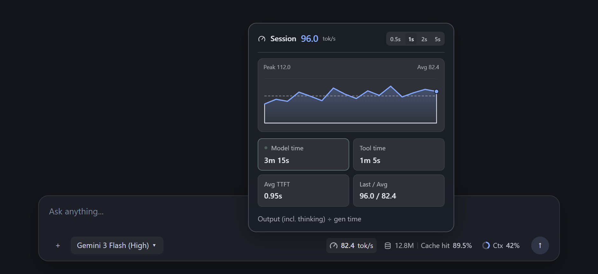
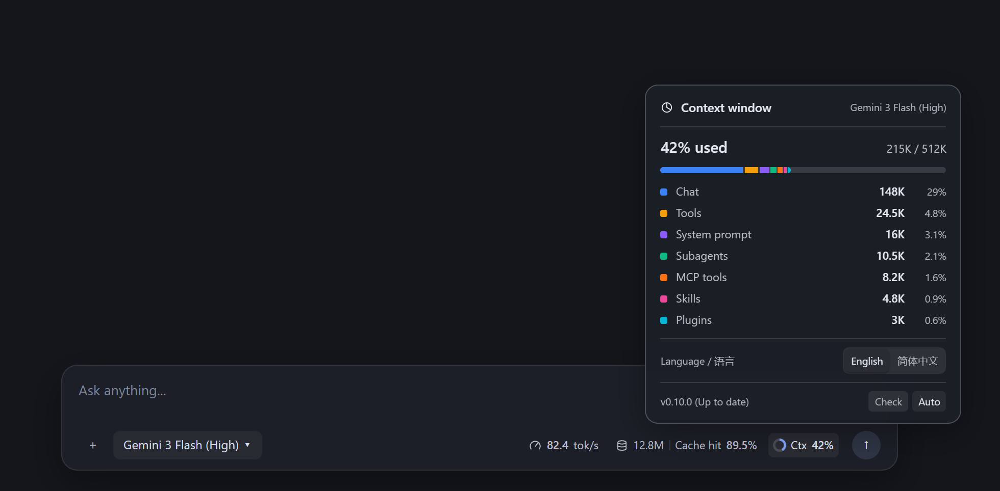
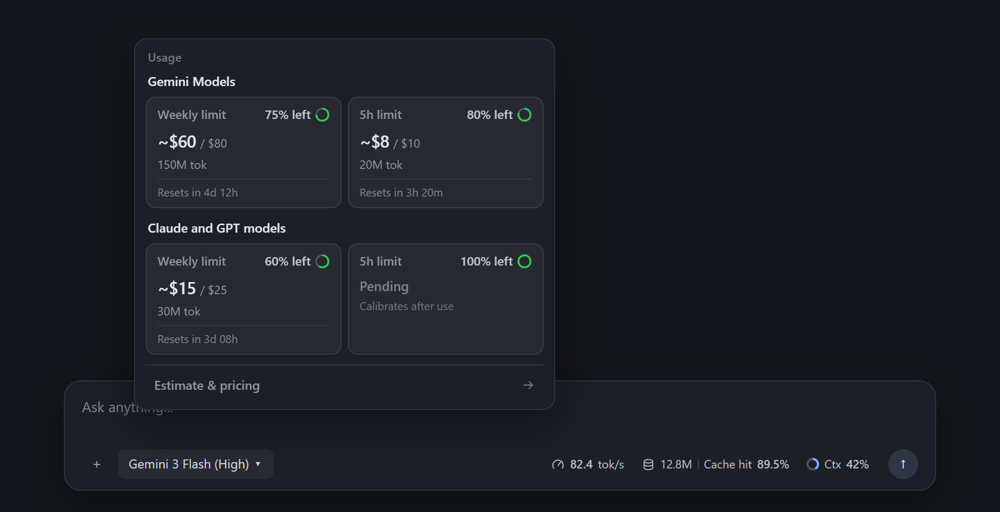
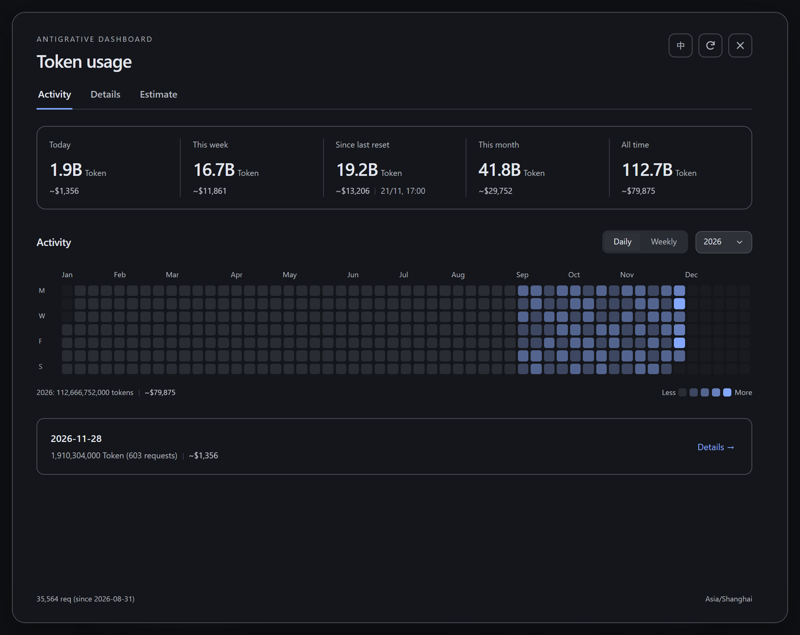
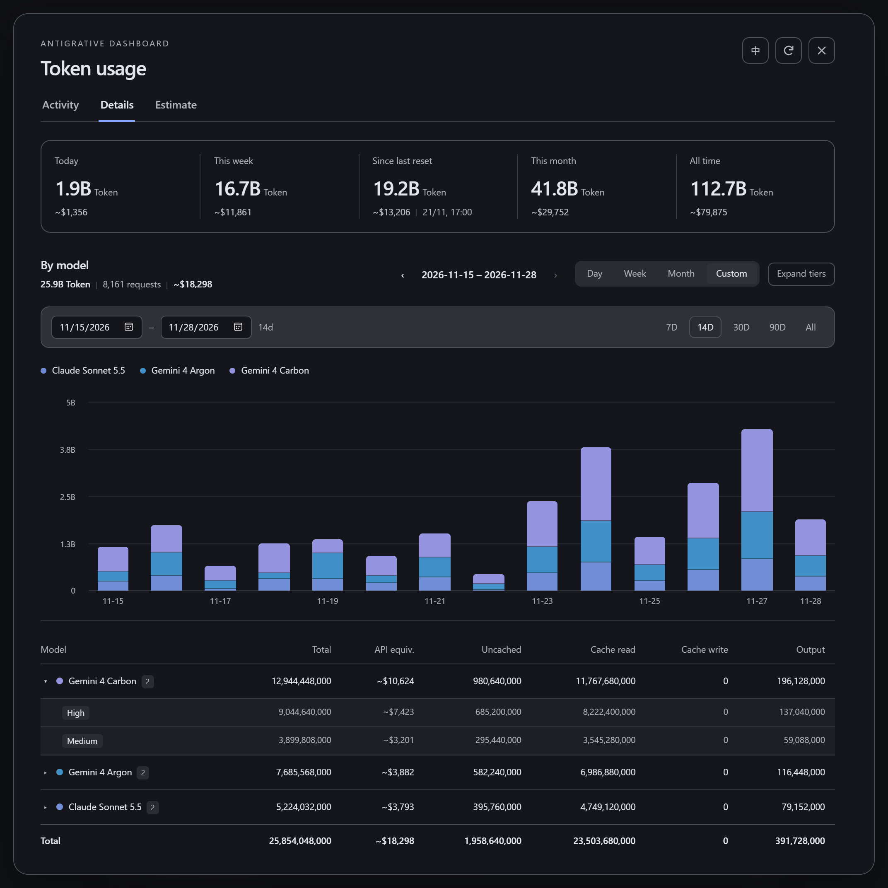
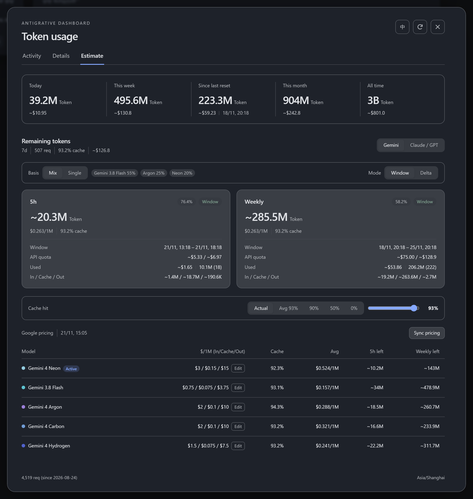

# antigravity-dashboard

A status bar and token usage dashboard plugin for Antigravity.

[简体中文](README.zh-CN.md)

## Features

- **Inline status bar**: Shows generation speed, cache hit rate, and context usage beside the input box. Hover for a quick preview, click for details.
- **Live TPS chart**: Tracks generation speed over time along with live model and tool time.
- **Context breakdown**: Shows how much of the context window is taken up by each part of the conversation.
- **Quota estimates in View Usage**: Displays equivalent API budget and estimated remaining tokens directly inside Antigravity's built-in usage popup.
- **Token usage dashboard**: Summarizes local history and equivalent API cost by time range, model, and thinking level.
- **Updates & multi-surface support**: Includes built-in update checks, English/Chinese switching, plus standalone IDE and CLI adapters.

## Screenshots

### TPS chart & status bar



### Context breakdown



### Quota estimates in View Usage



### Activity overview



### Usage details



### Remaining quota estimate & pricing



## Install

Requires Python 3 and Antigravity.

Download the latest ZIP from [Releases](https://github.com/NoobCock/antigravity-dashboard/releases/latest) or clone this repository, then run:

```bash
git clone https://github.com/NoobCock/antigravity-dashboard.git
cd antigravity-dashboard
python manage.py install
```

Fully quit and reopen Antigravity after installing.

### Disable or uninstall

```bash
python manage.py disable
python manage.py uninstall
```

For standalone IDE and CLI setup, see [IDE guide](ide/README.md) and [CLI guide](docs/CLI.md).

## License

[MIT](LICENSE)
