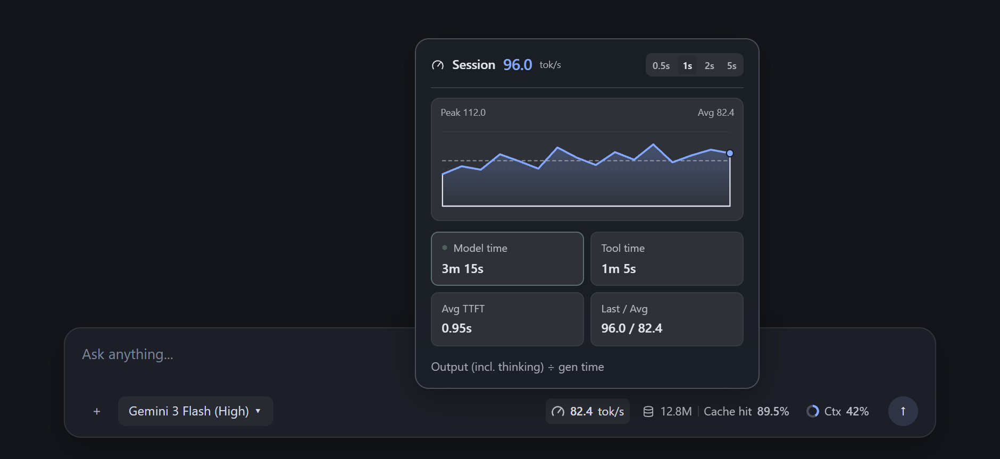

# antigravity-dashboard

适用于 Antigravity 的状态栏与用量统计插件。

[English](README.md)

## 功能

- **状态栏统计**：在输入框旁显示生成速度、缓存命中率和上下文占用，悬停看简略信息，点击看详情。
- **TPS 折线图**：查看实时生成速度曲线，以及模型与工具的运行用时。
- **上下文占用明细**：展开查看当前对话中各部分内容的上下文占比。
- **额度与预算估算**：在自带的额度弹窗中直接显示等效 API 额度与预计剩余 Token。
- **用量统计面板**：汇总本地历史用量与等效 API 费用，支持按时间、模型和思考等级查看。
- **自动更新与多端支持**：内置版本检查与中英文切换，另提供独立 IDE 插件与 CLI 状态栏。

## 界面预览

### TPS 折线图与状态栏



### 上下文占用明细


### 自带额度弹窗中的预算估算


### 用量概览


### 按模型与思考等级统计


### 剩余额度测算与定价


## 安装

需要 Python 3 和 Antigravity。

从 [Releases](https://github.com/NoobCock/antigravity-dashboard/releases/latest) 下载最新版本解压，或克隆仓库后运行：

```bash
git clone https://github.com/NoobCock/antigravity-dashboard.git
cd antigravity-dashboard
python manage.py install
```

安装后完全退出并重启 Antigravity 即可生效。

### 停用或卸载

```bash
python manage.py disable
python manage.py uninstall
```

独立 IDE 与 CLI 安装方式见 [IDE 说明](ide/README.md) 和 [CLI 说明](docs/CLI.md)。

## 许可

[MIT](LICENSE)
