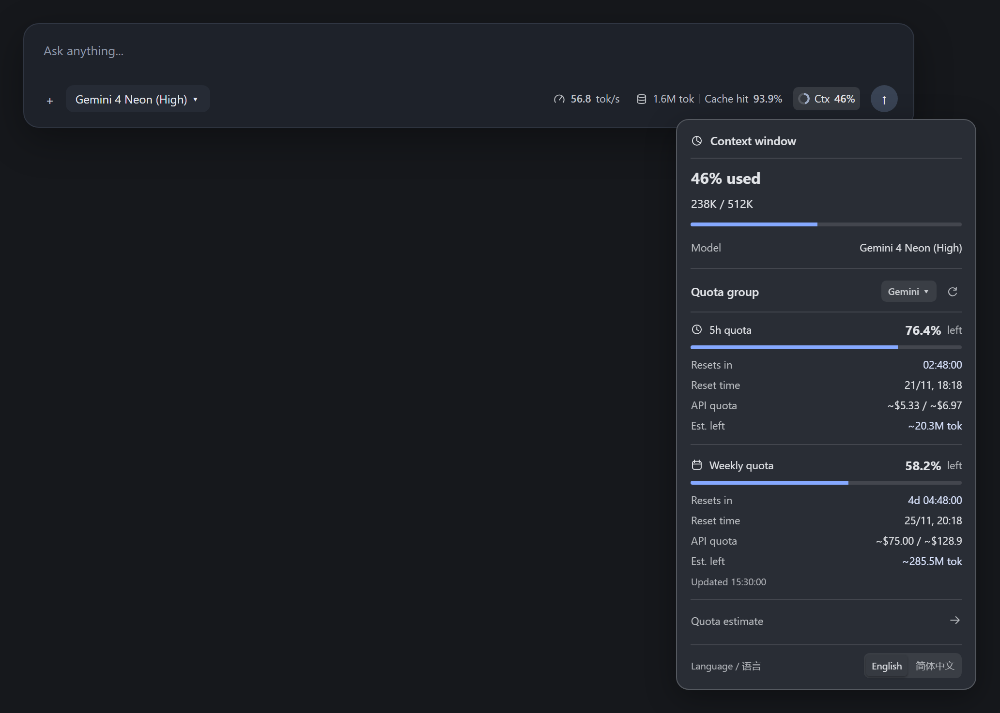
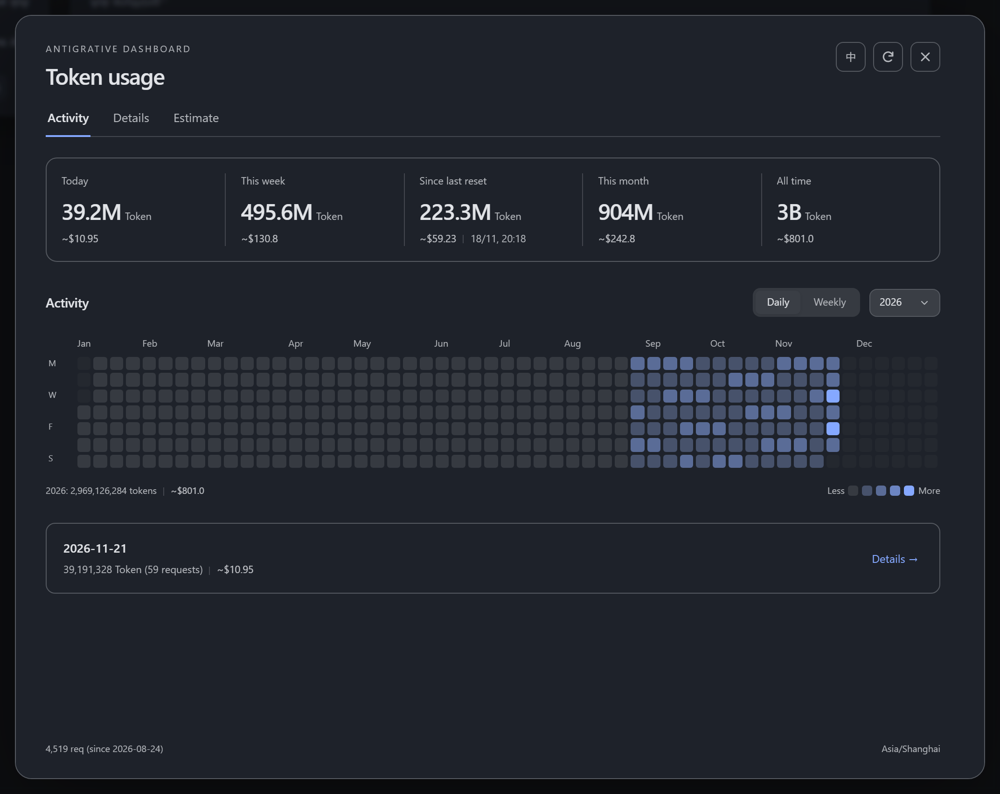
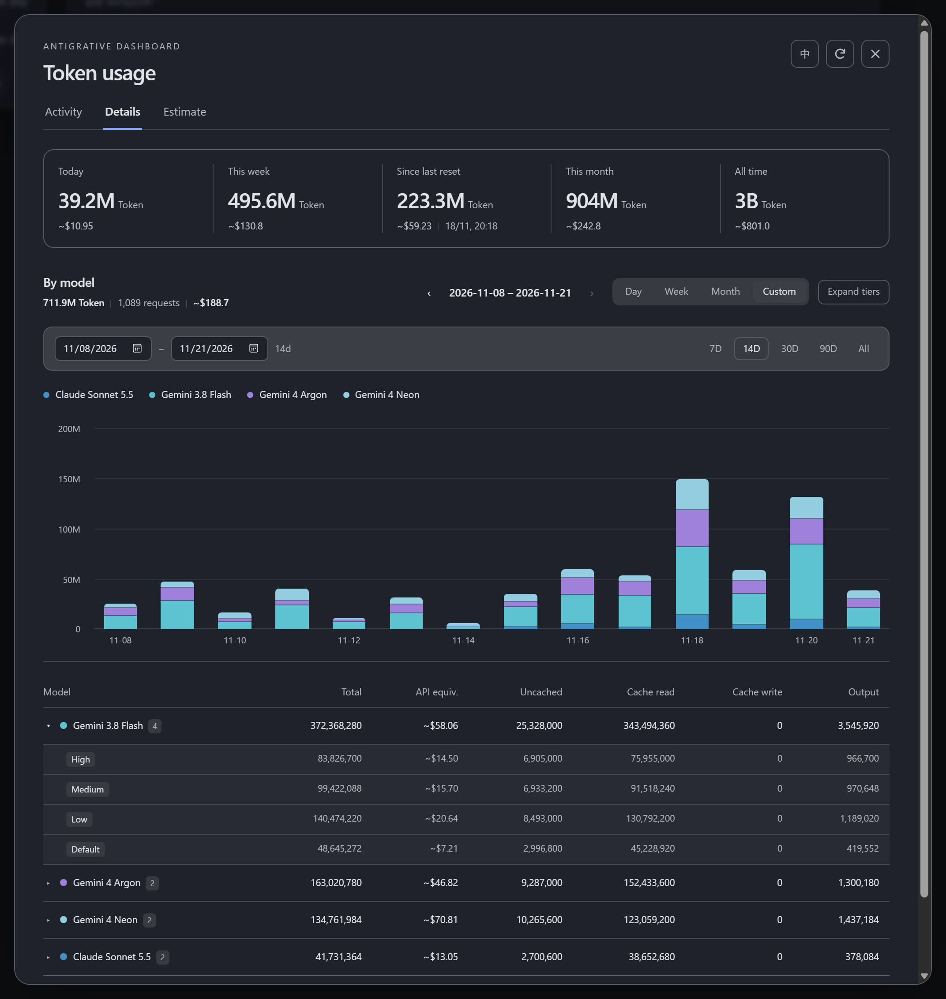
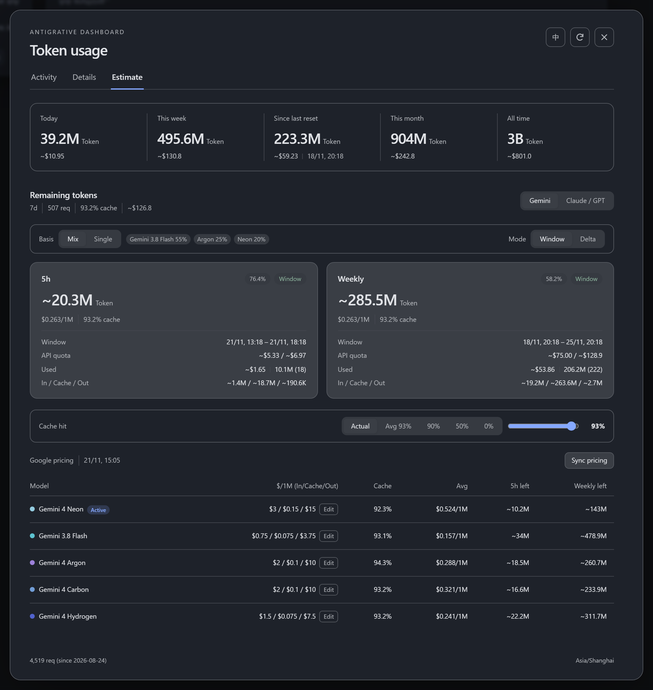

# antigravity-dashboard

适用于 Antigravity 的状态栏与 Token 用量统计插件。

[English](README.md)

## 功能

- **输入框状态栏**：在输入框旁实时显示输出速度、缓存命中率和上下文占用。
- **额度与重置倒计时**：查看 5 小时和周额度剩余比例、重置时间以及预计剩余可用 Token。
- **用量统计与等效 API 金额**：自动汇总本地历史对话，按今日、本周、上次重置以来、本月和累计统计 Token 及对应 API 费用。
- **自定义时间与模型明细**：支持按天、周、月和自定义日期查看柱状图与明细表；自动合并同模型变体，并按思考等级折叠，点击可展开查看。
- **剩余 Token 测算**：支持按近期使用比例或指定单模型测算剩余可用 Token，支持同步谷歌官方 API 定价、自定义模型价格及调整缓存命中率。
- **中英文切换**：支持中英文界面一键切换。

## 截屏

### 输入框状态栏与额度卡片



### 活动概览



### 用量详情（自定义时间范围与思考等级折叠）



### 剩余额度测算



## 安装

需要 Python 3 和 Antigravity（2.34+）。

```bash
git clone https://github.com/NoobCock/antigravity-dashboard.git
cd antigravity-dashboard
python manage.py install --panel-only
```

安装后重启 Antigravity 即可生效。

### 停用或卸载

```bash
python manage.py disable
python manage.py uninstall
```

## 许可

[MIT](LICENSE)
